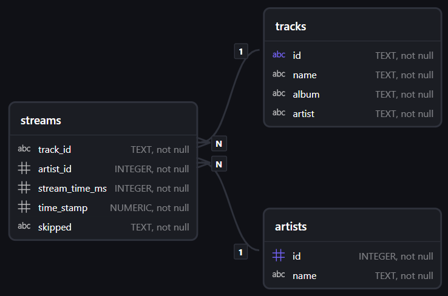

# 🎵 Spotify Wrapped: Personal Streaming Data Warehouse & SQL Analytics

**Author:** Francisco Mendez, PhD  
**Role:** Research / Data Scientist  
**Deliverables:** [📹 Video Presentation](https://youtu.be/Hte74b8Dfes) | [📊 Presentation Slide Deck (PDF)](spotify_wrapped_2026_presentation.pdf) | [🧹 ETL & Cleaning Notebook](spotify_data_cleaning.ipynb) | [🗄️ Database Schema](schema.sql) | [🔍 SQL Queries](queries.sql) | [🎓 CS50 SQL Certificate](https://cs50.harvard.edu/certificates/21410a33-c78e-4067-bce9-36ba8448307b) | [💼 LinkedIn](https://www.linkedin.com/in/fmendez-phd/)

[](https://www.linkedin.com/in/fmendez-phd/)
[](https://cs50.harvard.edu/certificates/21410a33-c78e-4067-bce9-36ba8448307b)
[](https://www.sqlite.org/)
[](schema.sql)
[](spotify_data_cleaning.ipynb)
[](https://developer.spotify.com/)

---

## 📌 Executive Summary

Every year, Spotify launches its viral **Spotify Wrapped** campaign, giving millions of users a high-level summary of their yearly listening habits. While visually compelling, the native Wrapped experience operates as an opaque summary: users cannot query their underlying playback data, inspect behavioral nuances (such as skip frequencies), or analyze temporal distributions on their own terms.

This project was developed as the **Capstone / Final Project for Harvard University's CS50: Introduction to Databases with SQL** course ([view verified certificate](https://cs50.harvard.edu/certificates/21410a33-c78e-4067-bce9-36ba8448307b)). It designs and implements an **end-to-end personal streaming data warehouse and analytics workflow** using data extracted via the **Spotify Developer Web API**. Spanning **January 8 to September 18, 2026**, the dataset captures **4,214 individual playback events** across **1,910 unique tracks** and **551 distinct artists**.

Using relational database design principles, the project establishes a **star schema** in SQLite, implements indexing and view abstractions for query acceleration, and conducts rigorous SQL-based exploratory and behavioral data analysis.

### Key Metrics at a Glance
* **Total Streaming Volume:** 13,123 minutes (~218.7 hours / ~9.1 days of continuous audio)
* **Total Recorded Streams:** 4,214 playback events
* **Distinct Catalog Reach:** 1,910 songs across 551 artists
* **Active Listening Days:** 174 days
* **Daily Average Listening:** 75 minutes / active day
* **Peak Single-Day Listening:** 428 minutes (~7.1 hours) on May 9, 2026

---

## 🎥 Project Presentation & Slide Deck

A comprehensive 3-minute executive video walkthrough and companion slide deck accompany this project:

* 📺 **Video Walkthrough:** [Watch the Presentation on YouTube](https://youtu.be/Hte74b8Dfes)
* 📄 **Executive Presentation Deck:** [Download Presentation (PDF)](spotify_wrapped_2026_presentation.pdf)

---

## 🧹 Data Ingestion, Cleaning & Dimensional Modeling (ETL)

The end-to-end data preparation workflow is documented and fully reproducible in the Jupyter notebook [`spotify_data_cleaning.ipynb`](spotify_data_cleaning.ipynb). It transforms raw, nested streaming history logs into a clean, normalized relational structure suitable for database ingestion.

### 1. Raw JSON Ingestion & Field Mapping
Raw listening records extracted from Spotify (`Streaming_History_Audio_2026.JSON`) were ingested using Pandas. Nested and verbose API metadata fields were extracted and mapped to standardized, relational snake_case schema columns:

| Raw Spotify API Field | Cleaned Column Name | Target Table | Description |
|:---|:---|:---|:---|
| `spotify_track_uri` | `track_id` | `tracks`, `streams` | Canonical track URI (`spotify:track:...`) |
| `master_metadata_track_name` | `name` / `track_name` | `tracks` | Track title |
| `master_metadata_album_album_name` | `album` / `album_name` | `tracks` | Album title |
| `master_metadata_album_artist_name` | `artist` / `artist_name` | `tracks`, `artists` | Artist name |
| `ms_played` | `stream_time_ms` | `streams` | Playback duration in milliseconds |
| `ts` | `time_stamp` | `streams` | ISO-8601 UTC timestamp of stream event |
| `skipped` | `skipped` | `streams` | Binary skip flag (`True` / `False`) |

Records with missing track URIs or missing essential metadata were pruned using `.dropna()`.

### 2. Relational Decomposition & Normalization
To transform the flat stream records into an optimized star schema, the data was partitioned into dimensional and fact entities:

* **Artists Dimension (`artists.csv`):**
  Extracted all unique artist names (`unique_artists = track_streams_df.sort_values(by='artist_name')['artist_name'].unique()`) and assigned a compact, zero-indexed surrogate integer ID (`0` to `550`). In SQLite, an `INTEGER PRIMARY KEY` directly aliases the 64-bit internal `rowid`, enabling $O(1)$ B-tree lookups and drastically reducing storage footprint compared to repeating string keys.
* **Tracks Dimension (`tracks.csv`):**
  Isolated track attributes (`track_id`, `track_name`, `album_name`, `artist_name`) and deduplicated records using `.drop_duplicates(subset='track_id')`, ensuring exactly 1,910 unique song entities identified by their globally unique Spotify track URI.
* **Streams Fact Table (`streams.csv`):**
  Mapped each event's artist name to its corresponding surrogate `artist_id` via vector lookup. Dropped redundant descriptive strings to retain only foreign keys and granular event metrics (`track_id`, `artist_id`, `stream_time_ms`, `time_stamp`, `skipped`).

### 3. Clean CSV Export
The resulting DataFrames were exported to header-compliant CSV files (`artists.csv`, `tracks.csv`, `streams.csv`), structured specifically for high-throughput bulk ingestion via SQLite's `.import` command.

---

## 🏗️ Data Architecture & Relational Design

The database (`spotify_wrapped_2026.db`) models streaming history using a **star schema** where playback events serve as the central fact table surrounded by song and artist dimensions.

### Entity Relationship Diagram (ERD)



### Schema Specification

#### 1. Fact Table: `streams`
Represents individual playback events recorded at the point of consumption.
* `track_id` (`TEXT NOT NULL`): Foreign key referencing `tracks(id)` via Spotify track URI.
* `artist_id` (`INTEGER NOT NULL`): Foreign key referencing `artists(id)`.
* `stream_time_ms` (`INTEGER NOT NULL DEFAULT 0`): Playback duration in milliseconds. Integer representation eliminates floating-point rounding errors during downstream time aggregations.
* `time_stamp` (`NUMERIC NOT NULL`): ISO-8601 UTC timestamp of the playback event (`YYYY-MM-DDTHH:MM:SSZ`).
* `skipped` (`TEXT NOT NULL`): Domain-restricted categorical flag with a `CHECK("skipped" IN ('True','False'))` constraint ensuring strict binary integrity.

```sql
CREATE TABLE streams (
    "track_id" TEXT NOT NULL,
    "artist_id" INTEGER NOT NULL,
    "stream_time_ms" INTEGER NOT NULL DEFAULT 0,
    "time_stamp" NUMERIC NOT NULL,
    "skipped" TEXT NOT NULL CHECK("skipped" IN ('True','False')),
    FOREIGN KEY("track_id") REFERENCES tracks("id"),
    FOREIGN KEY("artist_id") REFERENCES artists("id")
);
```

#### 2. Dimension Table: `tracks`
Contains track-level metadata.
* `id` (`TEXT PRIMARY KEY`): Unique natural key corresponding to the globally unique Spotify track URI (e.g., `spotify:track:5icLTeOSXTvkLIi08P2k4g`).
* `name` (`TEXT NOT NULL`): Title of the song.
* `album` (`TEXT NOT NULL`): Album name.
* `artist` (`TEXT NOT NULL`): Artist name associated with the track.

```sql
CREATE TABLE tracks (
    "id" TEXT NOT NULL,
    "name" TEXT NOT NULL,
    "album" TEXT NOT NULL,
    "artist" TEXT NOT NULL,
    PRIMARY KEY("id")
);
```

#### 3. Dimension Table: `artists`
Contains artist entities identified in the listening history.
* `id` (`INTEGER PRIMARY KEY`): Monotonically increasing surrogate key (aliased directly to SQLite's 64-bit signed integer `rowid` for $O(1)$ primary-key lookups).
* `name` (`TEXT NOT NULL`): Artist or performer name.

```sql
CREATE TABLE artists (
    "id" INTEGER NOT NULL,
    "name" TEXT NOT NULL,
    PRIMARY KEY("id")
);
```

---

## ⚡ Performance Optimization & Indexing Strategy

In streaming analytics, aggregation queries frequently join high-volume event logs against catalog tables and perform multi-dimensional grouping. To minimize full table scans, three B-tree indexes and a reusable analytical view were deployed:

```sql
-- 1. Accelerate streams ⋈ tracks joins and GROUP BY t.id
CREATE INDEX "stream_track_index" ON "streams"("track_id");

-- 2. Accelerate streams ⋈ artists joins and GROUP BY a.id
CREATE INDEX "stream_artist_index" ON "streams"("artist_id");

-- 3. Accelerate categorical filtering for skip-behavior analytics
CREATE INDEX "stream_skipped_index" ON "streams"("skipped");
```

### Analytical View Abstraction
A materialized view abstraction (`daily_streaming_time`) encapsulates the date extraction and millisecond-to-minute conversion logic, establishing a single source of truth for daily aggregate metrics:

```sql
CREATE VIEW "daily_streaming_time" AS
SELECT
    strftime('%Y-%m-%d', time_stamp) AS Day,
    (SUM(stream_time_ms) / 1000) / 60 AS total_stream_minutes
FROM
    streams
GROUP BY
    Day;
```

---

## 📊 Analytical Insights & SQL Implementations

### 1. Macro Volume: Annual Streaming Minutes
Calculates total streaming time converted from raw milliseconds to integer minutes:

```sql
SELECT
    (SUM(stream_time_ms) / 1000) / 60 AS total_stream_minutes
FROM
    streams;
```
> **Result:** **13,123 minutes** (~218.7 hours) across 4,214 playback events.

---

### 2. Preference Ranking: Top 5 Songs & Artists
Joins the central fact table against `tracks` and `artists` dimensions to rank consumption volume:

| Rank | Top Songs (`queries.sql`) | Artist | Minutes | Top Artists (`queries.sql`) | Minutes |
|:---:|:---|:---|:---:|:---|:---:|
| **1** | **Spit Out The Bone** | Metallica | 130 min | **Metallica** | 3,875 min |
| **2** | **Damage, Inc.** | Metallica | 103 min | **Ghost** | 862 min |
| **3** | **Sweet** | Lana Del Rey | 84 min | **Rammstein** | 697 min |
| **4** | **Leper Messiah** | Metallica | 84 min | **Megadeth** | 514 min |
| **5** | **Battery** | Metallica | 81 min | **Disturbed** | 417 min |

```sql
-- Top Songs Query
SELECT
    t.name AS Song,
    a.name AS Artist,
    (SUM(stream_time_ms) / 1000) / 60 AS total_stream_minutes
FROM streams AS s
    JOIN tracks AS t ON s.track_id = t.id
    JOIN artists AS a ON s.artist_id = a.id
GROUP BY t.id
ORDER BY total_stream_minutes DESC
LIMIT 5;
```

---

### 3. Behavioral Analysis: The "Skip Paradox"
Filtering on `skipped = 'True'` reveals the most skipped songs and artists:

```sql
SELECT
    a.name AS Artist,
    COUNT(s.skipped) AS "Total Skips"
FROM streams AS s
    JOIN artists AS a ON s.artist_id = a.id
WHERE s.skipped = 'True'
GROUP BY a.id
ORDER BY "Total Skips" DESC
LIMIT 5;
```

| Rank | Most Skipped Songs | Skips | Most Skipped Artists | Total Skips |
|:---:|:---|:---:|:---|:---:|
| **1** | *Here Comes Revenge* (Metallica) | 6 | **Metallica** | **175** |
| **2** | *The Ecstasy Of Gold* (Ennio Morricone) | 5 | **Megadeth** | **71** |
| **3** | *Post Mortem / Raining Blood* (Havok) | 5 | **Rammstein** | **66** |
| **4** | *Masked Ball - 1999 Ext. Mix* (Jocelyn Pook) | 5 | **Ghost** | **66** |
| **5** | *Duel of the Fates* (John Williams) | 5 | **Disturbed** | **47** |

> 💡 **Data Science Takeaway — The Skip Paradox:**  
> A naive analysis might assume high skip rates indicate disinterest. However, **Metallica** simultaneously dominates both total listening time (3,875 minutes) and total skips (175 skips). In continuous playback environments, **high playback exposure mechanically increases absolute skip opportunities**. High skips for primary artists reflect queue management and active curation rather than genuine aversion.

---

### 4. Seasonality & Temporal Distribution
Using SQLite's `strftime` and a declarative `CASE` statement to analyze seasonal volume shifts:

```sql
SELECT
    CASE strftime('%m', s.time_stamp)
        WHEN '01' THEN 'January'   WHEN '02' THEN 'February'
        WHEN '03' THEN 'March'     WHEN '04' THEN 'April'
        WHEN '05' THEN 'May'       WHEN '06' THEN 'June'
        WHEN '07' THEN 'July'      WHEN '08' THEN 'August'
        WHEN '09' THEN 'September'
    END AS Month,
    (SUM(stream_time_ms) / 1000) / 60 AS total_stream_minutes
FROM streams AS s
GROUP BY Month
ORDER BY strftime('%m', s.time_stamp);
```

```
Monthly Streaming Trend (Minutes):
Jan [████████████████████████] 2,275 min
Feb [████████████████]         1,532 min
Mar [███████████]              1,073 min
Apr [█████████]                  888 min (Spring trough)
May [█████████████]            1,297 min
Jun [██████████████]           1,319 min
Jul [████████████████████]     1,940 min
Aug [█████████████████████]    1,994 min (Summer peak)
Sep [████████]                   800 min (Partial month to Sep 18)
```

---

### 5. Daily Volatility: CTE vs. View Benchmarking
To identify extreme listening days, the analysis implements both a Common Table Expression (CTE) and the optimized SQL View:

#### Option A: Common Table Expression (CTE)
```sql
WITH daily_streams AS (
    SELECT
        strftime('%Y-%m-%d', time_stamp) AS Day,
        (SUM(stream_time_ms) / 1000) / 60 AS total_stream_minutes
    FROM streams
    GROUP BY Day
)
SELECT Day, total_stream_minutes
FROM daily_streams
ORDER BY total_stream_minutes DESC
LIMIT 10;
```

#### Option B: Reusable View Abstraction
```sql
SELECT Day, total_stream_minutes
FROM daily_streaming_time
ORDER BY total_stream_minutes DESC
LIMIT 10;
```

#### Daily Central Tendency (Active Days Average)
```sql
SELECT ROUND(AVG(total_stream_minutes), 0) AS daily_average_minutes
FROM (
    SELECT
        strftime('%Y-%m-%d', time_stamp) AS Day,
        (SUM(stream_time_ms) / 1000) / 60 AS total_stream_minutes
    FROM streams
    GROUP BY Day
);
```

* **Active-Day Mean:** **75 minutes / day**
* **Peak Single Day:** **May 9, 2026** (428 minutes / ~7.1 hours)

---

## 📁 Repository Structure

```text
├── README.md                              # Professional portfolio overview & documentation
├── DESIGN.md                              # In-depth architectural specification & CS50 design doc
├── ERD.png                                # Entity-Relationship Diagram
├── schema.sql                             # DDL: Table creation, constraints, indexes & views
├── queries.sql                            # Production analytical queries & benchmarks
├── spotify_wrapped_2026.db                # SQLite database instance
├── spotify_wrapped_2026_presentation.pdf  # Executive presentation slide deck
├── spotify_wrapped_2026_presentation.pptx # Raw widescreen PowerPoint presentation
├── presentation_script.txt                # 3-minute video presentation script with cues
├── spotify_data_cleaning.ipynb            # Jupyter notebook for API ingestion, cleaning & normalization
├── artists.csv                            # Cleaned artists dimensional CSV
├── tracks.csv                             # Cleaned tracks dimensional CSV
└── streams.csv                            # Cleaned streaming events fact CSV
```

---

## 🚀 Quickstart & Reproduction Guide

### Prerequisites
* SQLite3 installed (`sqlite3 --version`)
* Python 3.10+ with `pandas` and `tqdm` (for running the data cleaning notebook)

### 1. Execute ETL Pipeline (Optional)
To re-generate the CSV files from raw JSON streaming logs:
```bash
jupyter execute spotify_data_cleaning.ipynb
```

### 2. Initialize Database & Execute Schema
```bash
sqlite3 spotify_wrapped_2026.db < schema.sql
```

### 3. Populate Data from CSV Files
Launch the SQLite CLI and import the raw dataset:
```sql
.mode csv
.import --skip 1 ./artists.csv artists
.import --skip 1 ./tracks.csv tracks
.import --skip 1 ./streams.csv streams
```

### 4. Execute Analytical Suite
Run the test queries directly from terminal:
```bash
sqlite3 -header -column spotify_wrapped_2026.db < queries.sql
```

---

## ⚖️ Engineering Trade-offs & Limitations

1. **Collaboration Granularity (1:N vs. M:N):**  
   Each stream record stores a single `artist_id`, and `tracks.artist` stores a single string. On collaborative songs or featured appearances, stream credit defaults to the primary artist, under-representing secondary collaborators. A production warehouse would model this with a `track_artists` junction table containing fractional contribution weights.
2. **Denormalization in Catalog Entities:**  
   `tracks.artist` duplicates metadata stored in `artists.name`. While this accelerates ad-hoc track queries by avoiding a join, it introduces potential update anomalies if not enforced by database triggers.
3. **Temporal Precision & Timezone Bias:**  
   Timestamps are stored in UTC ISO-8601 strings. Because date aggregations use UTC calendar days, playback occurring late in local evening hours is credited to the subsequent UTC date.
4. **Active-Day vs. Calendar-Day Averaging:**  
   The daily average of 75 minutes calculates central tendency over the 174 days with recorded playback activity, excluding days with zero streams.

---

## 👨‍💻 About the Author

**Francisco Mendez, PhD**  
*Research / Data Scientist & Quantitative Researcher*  

* 💼 **LinkedIn:** [linkedin.com/in/fmendez-phd](https://www.linkedin.com/in/fmendez-phd/)
* 🎓 **Harvard CS50 SQL Certificate:** [View Verified Credential](https://cs50.harvard.edu/certificates/21410a33-c78e-4067-bce9-36ba8448307b)
* 🎥 **Video Presentation:** [Watch on YouTube](https://youtu.be/Hte74b8Dfes)
* 📑 **Slide Deck:** [Download Presentation Deck (PDF)](spotify_wrapped_2026_presentation.pdf)
* 🧹 **Data Cleaning Notebook:** [`spotify_data_cleaning.ipynb`](spotify_data_cleaning.ipynb)
